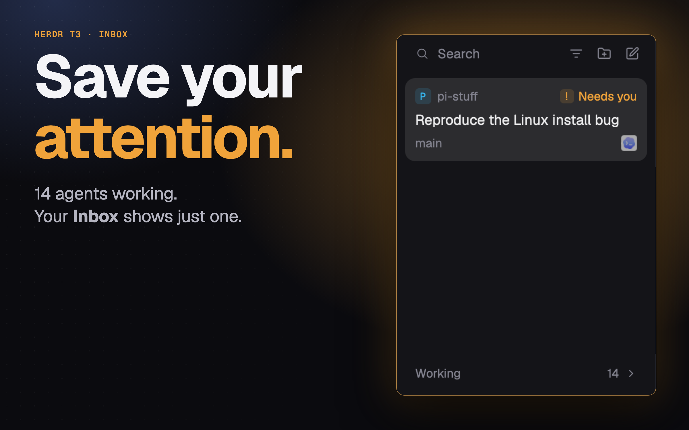

# T3 Focus for Herdr App

English · [中文](README.zh-CN.md)

A Herdr App sidebar mod with [T3 Code](https://github.com/pingdotgg/t3code)-style Settle: agents that need you stay up top as cards; finished ones are settled by hand into a quiet list at the bottom and come back on new work.

It is the focus sidebar of the [Herdr T3 layout](https://github.com/JinJieBeWater/herdr-t3), on its own. The layout also hides a settled agent's done dot in the tabs and switches between this list and Spaces/Agents.

## Install

Ask your Herdr agent to add `herdr.dev/mods/JinJieBeWater/herdr-t3-focus`, or copy `mods/t3-focus/` into `~/.config/herdr-app/mods/`. It docks on the left the first time Herdr sees it. How it should look and behave: [RECIPE.md](RECIPE.md).

## What it runs

- `hc label <agent> settled=<ms>:<turn>` when you settle or unsettle an agent, or when new work unsettles it. Nothing else; no network, no files outside its folder.

## License

Apache-2.0, as Herdr App.

## More

- [herdr-t3](https://github.com/JinJieBeWater/herdr-t3): the full Herdr T3 layout this sidebar comes from.
- [herdling](https://github.com/JinJieBeWater/herdling): a macOS menu bar companion for Herdr.
- [pi-stuff](https://github.com/JinJieBeWater/pi-stuff): my Pi extensions and skills.
