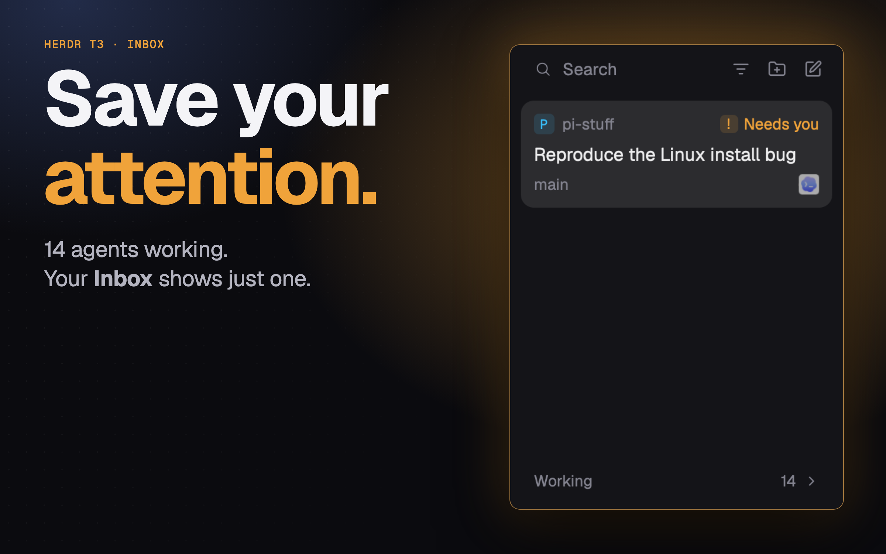

# T3 Focus for Herdr App

[English](README.md) · 中文

Herdr App 的侧栏 mod，带 [T3 Code](https://github.com/pingdotgg/t3code) 式 Settle：需要你处理的 agent 以卡片形式留在上方；处理完的手动 Settle，收进底部安静的列表；有新工作时自动回来。

它就是 [Herdr T3 布局](https://github.com/JinJieBeWater/herdr-t3) 里的 Focus 侧栏，单独拿出来。整套布局还会在标签栏隐藏已 Settle agent 的完成圆点，并能在这个列表和 Spaces/Agents 之间切换。

## 安装

让你的 Herdr agent 添加 `herdr.dev/mods/JinJieBeWater/herdr-t3-focus`，或者把 `mods/t3-focus/` 复制进 `~/.config/herdr-app/mods/`。Herdr 第一次看到它时会停靠在左侧。外观和行为见 [RECIPE.zh-CN.md](RECIPE.zh-CN.md)。

## 它会运行什么

- Settle、取消 Settle，或新工作让 agent 自动回来时，运行 `hc label <agent> settled=<ms>:<turn>`。除此之外不运行别的程序，不发网络请求，不读自己目录以外的文件。

## 许可证

Apache-2.0，与 Herdr App 相同。

## 更多

- [herdr-t3](https://github.com/JinJieBeWater/herdr-t3)：这个侧栏所在的完整 Herdr T3 布局。
- [herdling](https://github.com/JinJieBeWater/herdling)：Herdr 的 macOS 菜单栏伴侣。
- [pi-stuff](https://github.com/JinJieBeWater/pi-stuff)：我写的 Pi 扩展和 Skills。
