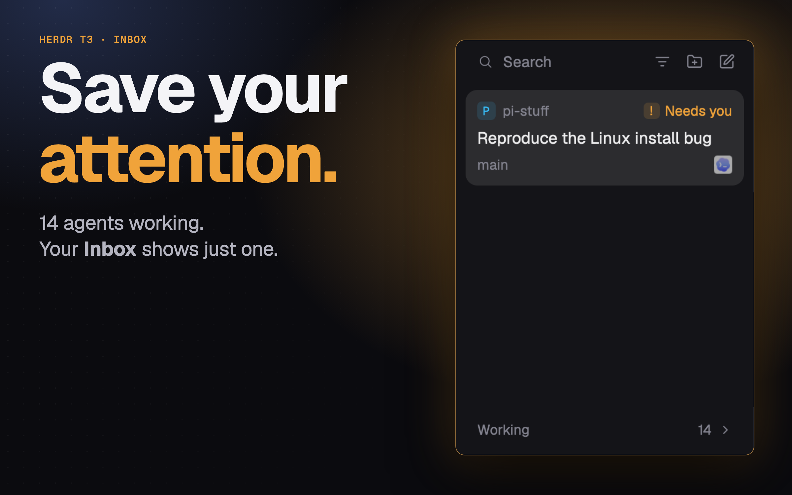

# T3 Inbox

A sidebar for Herdr App that keeps only the agents still asking for your attention in sight, as cards, newest news first. Agents you are done with are settled by hand and sink into a quiet, folded list at the bottom; any new work brings them back. Modeled on the Settle sidebar of [T3 Code](https://github.com/pingdotgg/t3code).

## What you see

Top to bottom, on the `chrome` theme background, 13px text:

1. **Top row** (32px, left padding 8, right 10): a wide `Search` button (26px high, search icon + "Search"), then three 26px square icon buttons: space filter (`list-filter.svg`, or the chosen space's mark, two overlapping marks when several), New space (`folder-plus`), New tab (`square-pen`).
2. **Cards** (scrolling list, padding 8, gap 2): one per agent that isn't settled and isn't working. Card: padding 10/8, radius 10, `selected` background when it is the focused agent, `hover` background otherwise on hover.
   - Line 1 (20px, 12px `dim` text): the space's 16px mark (below), space name, then the corner.
   - Line 2: title at 14px. As T3's, it leads (`foreground`, medium) when focused, blocked or done, else recedes (`muted`, normal); hovering brightens it, in color only.
   - Line 3, only when there is something to say (12px `dim`): branch, and "N sub-agents working".
   - Marks: the 16px program icon at 60% opacity, after a 14px `dim` server mark for an agent on another machine, naming the machine on hover. They end line 3 when the card has one, else line 2, so the title keeps its line.
   - Corner: `Needs you` (amber `blocked`, a 14px `!` badge) for blocked, `Done` (green `ansi2`, circle-check) for done and not yet seen, else how long ago it last changed (`just now`, `5m`, `3h`, `2d`, as T3: no weeks).
   - Empty: "Nothing needs you." (or "No agent status yet…" when no agent has reported).
3. **Shelves**, pushed to the bottom by `margin-top: auto`:
   - **Working N** header (30px, 12px medium `dim`, count and chevron at the right), folded by default; open, it lists working agents as cards with a spinner pill `Working 9s` counting up (`4m`, then `1h 5m`), at 70% opacity until hovered or focused.
   - **Settled N** header, folded by default; open, it shows the 10 most recently settled as slim rows, then `Show 25 more`. A `Clear` button before the count closes the settled panes (not the one in view or its tab), after asking through the shipped `confirm` dialog (`Close N panes?`, whose command is `t3-inbox.clear`). Herdr closes emptied tabs. Spaces stay: one left empty first gets a shell tab where its terminals were (`panes().cwd`, not the space's starting folder, which would rename an unnamed space) (`tab.new`; `pane.close` refuses a space's last pane), then the view returns to the tab you were on. Sessions stay with the agent (`pi -r`, `claude -r`, `codex resume`).
   - Slim row: 30px, radius 8, led by the space's 16px mark at 40% opacity until focused or hovered, then a `muted` title and the settled-ago time at the right.

**Space marks**, as T3 Code draws a project (`mods/t3-inbox/project.js`): the project's own icon (radius 25%), looked for from the repo top of where the space is now (its first terminal's folder, else where it was made): T3's well-known files in order (`favicon.svg`, `public/favicon.ico`, … `.idea/icon.svg`), then a page's `<link rel="icon">` or a route's `{ rel: "icon", href }`. Found, it is copied to `cache/t3-icons/` in the app's folder, since images show only from there, and shared as `space.icons`; looked for again after 10 minutes, a missing one after a minute. Else a monogram: the name's first letter or digit, capitalized (`智能算量` → `智`), bold monospace at 0.64 of the mark, in one of T3's 18 colors hashed from the name on a 14% wash of it. A name with nothing to spell (`~`) shows a folder.

## How it behaves

- **Statuses.** `blocked`, or `error` (a failed turn, its own or a sub-agent's, read from `terminals()` since `agents()` has no such word) shows Needs you and stays up top. Next, its own `done`: its reply shows Done in Active, with its working sub-agents beside it, and once read it goes back to Working with the run's start. `working`, or an agent waiting on a working sub-agent, goes to the Working shelf. `idle` shows its age. The rule is `mods/t3-inbox/tree.js`, shared with Herdr T3.
- **Order.** Cards by when each last came back to you (a state change this mod saw; before that, the core's `status_ms`). Working by when its run started. Settled by when it was settled. Equal times go by address, so the order never follows the order the data came in. Looking at a card moves nothing. A run that stops stays on the Working shelf for 2s, as in T3, showing its real state meanwhile: going on within that keeps its place, and so does a pause for you (blocked) followed by more work; after it, the card lands on top of the cards. Blocked leaves at once; pinned and settled agents skip the grace. An agent missing from the list for a moment keeps its place; only ended terminals lose their record. The order is passed to `setAgentOrder`, settled agents last, so `agent.next` / `agent.prev` follow the list as it reads.
- **Click** a card or slim row: `agent.focus` on it (focuses its pane; in a layout with an agent block, shows it there). Viewing a settled agent leaves it settled.
- **Settle.** Hovering a card that is finished (nothing in its tree working or blocked) turns its corner into a `✓ Settle` button. Settling the focused agent moves focus to the next card down, wrapping from the top past the end, as T3; settling one in the background moves nothing. The key command `t3-inbox.settle` does the same for the agent in view (finished and unpinned), or brings it back if it is settled.
- **Unsettle.** Hovering a slim row turns its time into an undo arrow; clicking puts the agent back at the top of the cards.
- **Undo notice**, as T3's: Settle and Unpin show `Settled 2 agents, Undo` over the first shelf's header for 5s (200ms fade). A run of the same action counts together; Undo puts them back as they were, not as news. No key: ⌘Z belongs to the terminals.
- **Row details**, as T3's thread card: hovering a card or slim row hangs a `Popup` 4px to its right, from its top: the title, then its space, another machine's name, branch and program, 12px, 320px at most. 150ms to the first; while one is up or was under 400ms ago, the next opens at once. The first and the last fade over 150ms. A control lit in the row, a drag or a click on the row hides it.
- **Hover labels**, as T3's tooltips: every icon-only control and wordless mark names itself with a `HoverCard` (`tip.js`), with its bound key where it has one. A program's icon has none.
- **Motion**, as T3's: when rows change order or section, each that moved slides from where it was (the shelves' headers, Show more and the empty line too, so a row never slides over one), a new one fades in from 40px up or riding with the kept row above it, one that left fades out where it was; 150ms ease-out, none while dragging or for more than 40 rows at once. A dropped row slides from where it was let go. Hovering a row cross-fades its time with its Settle or undo button.
- **Drag.** As in T3: move a card or row 6px to lift it. While lifted, the `Pinned` and `Active` labels open, the lifted copy follows the pointer up and down and says what letting go does (`Pin`, `Unpin`, `Settle`, `Un-settle`), and the list opens a gap the size of the destination's row where it will land (a native 150ms `height` transition); empty or folded sections show a dashed placeholder. Onto Pinned pins (upper or lower half of a pin: above or below it), onto Active unpins and unsettles, onto Settled settles. Esc or leaving the sidebar sideways puts it back; leaving off the top or bottom lands it where the badge says (Herdr reports no release outside the sidebar); Working cards don't lift. Sweep: press `✓ Settle` or a settled row's undo and move across rows to settle or bring back the whole run. Pinned cards stay up top in pin order and offer no Settle button. Pins live in shared state `agents.pins`, the same list Herdr T3's agents list uses.
- **New work unsettles by itself:** the agent (or a sub-agent) becomes working or blocked, or the core's `turn` counter has passed the one stored at settle time, which also catches work done while no window was open.
- **Filter.** The filter button opens a popover (260px wide, at most 360 tall) with a search field and `All spaces` plus every space. Click shows that space alone; shift-click adds or removes it and keeps the menu open. Remembered on this screen.
- **Search** opens the shipped `picker`; **New space** runs `space.new`; **New tab** opens the mod named by the `newMenu` prop, else the shipped `new-menu`.
- **The row in view**, as T3's route row: it stays out of a folded shelf and past the Settled page; a sub-agent in view with no row of its own lights its nearest listed ancestor, and Settle acts on that card; an agent brought into view from elsewhere that the filter hides widens the filter to all spaces, kept (not on the first draw, and a filter picked while it's in view holds).
- Shelf folding, the filter and the last seen states are kept in the mod's `localStorage`. The rows as drawn are shared as `t3-inbox.rows` (`{ order, view }`), for a layout's keys to walk them.

## Built from

- One mod, `mods/t3-inbox/` (`main.js`, `name.js` (a card's title: the Pi session, a named tab, a telling terminal title, else the program), `tree.js` (the status rule), `project.js` (space marks), `tip.js` (hover labels), `details.js` (row details), `undo.svg`, `list-filter.svg`, `mod.json` docking it `left` at 300px). One optional prop, `newMenu`: the mod **New tab** opens (the Herdr T3 layout passes `t3-new-menu`).
- `herdr`: `agents()`, `terminals()` (`labels`, `turn`, `status_ms`, `parent`, `state`), `panes()` (branch, `cwd`), `spaces()`, `run` (`agent.focus`, `space.new`, `mod.open`, `tab.new`, `pane.close`), `openOverlay` (the `confirm` dialog), `hc`, `exec`, `notify`, `theme`, `shared` / `setShared` (`agents.pins`, `space.icons`, `t3-inbox.rows`), `keys`, `setAgentOrder`.
- `gpui-base`: `Popover`, `Popup`, `HoverCard`, `InputState`, `Input`, `v_flex`, `h_flex`.
- Programs: `hc label`; for space marks, on the space's machine, `git rev-parse --show-toplevel`, `sh -c` file tests and `base64`.
- Settled state is a core terminal label on the agent itself: `hc label <address> settled=<ms>:<turn>`; `settled=` removes it. It ends with the terminal and every mod and window can read it.
- Shipped icons: `mods/workspace-chrome/{search,folder,folder-plus,square-pen,check,circle-check,spinner,chevron-down,chevron-right,server,git-branch,pin}.svg`.

## Watch out

- A label written with `hc label` takes about 0.65s to come back in `terminals()`. Keep the new value as pending so the row moves at once; drop it on failure and show an error `notify`.
- `terminals()[].status_ms` is only as of the app's start; it is a fallback until the mod sees a change itself.
- Treat `done` and `idle` as one when tracking change times: looking at a done agent turns it idle, and looking is not news.
- Sub-agents without a pane aren't in `agents()`; walk `terminals()` by `parent` for them.
- A card moves away without a pointer-leave event: clear the hover state on Settle / Unsettle.
- A hover style reaches text but not an `svg`; keep hover as state so icon and label brighten together.
- Herdr eases only later changes to an element: a row that moves gets a new id, is drawn once where it was, then let go.
- Herdr can't scroll a plain list from code, so unlike T3 the row in view isn't scrolled into view.
- `.tooltip()` takes only a string in the shell's own style, hence a `HoverCard`; it doesn't flip, so what sits at the window's bottom must open upward itself. The details card is solid: T3's glass blurs what's behind it, and a mod can't.
- No auto-settle or snooze. Settling never touches the process.

## Done when

- `herdr-app check mods/t3-inbox` passes.
- A finished agent shows `✓ Settle` on hover; clicking moves it to Settled within a second and `hc get <address> --json` shows `settled=<ms>:<turn>`.
- That Settle shows `Settled 1 agent, Undo` for 5s; Undo puts it back as it was.
- Hovering a card fades its details in beside it; moving to the next card shows that one's at once.
- `Clear` asks through the `confirm` dialog before it closes anything.
- Sending that agent a new prompt brings it back to the cards and removes the label.
- Hovering a settled row and clicking the arrow puts it on top of the cards.
- With 11+ settled agents, the open shelf shows 10 and `Show N more`.
- `agent.next` walks the cards in their shown order.
